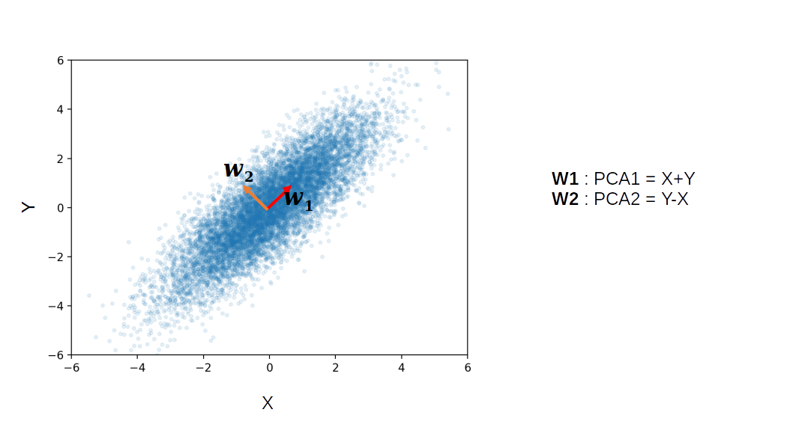

```{r}
library(gplots)
library(ggplot2)
library(GGally)
library(RColorBrewer)
library(umap)
library(recipes)
library(ggbiplot)
```

# Data exploration

## tidymodels 101

The main library we will be using for machine learning is [tidymodels](https://www.tidymodels.org/).

Tidymodels is actually a collection of packages handling different facets of Machine Learning:

-   [recipes](https://recipes.tidymodels.org/): handles data pre-processing
-   [parsnip](https://parsnip.tidymodels.org/): provides a unified interface for models
-   [rsamples](https://rsample.tidymodels.org/): handles re-sampling, bootstrapping, cross-validation, ...
-   [tune](https://tune.tidymodels.org/): handles hyper-parameter tuning
-   [yardstick](https://yardstick.tidymodels.org/): handles performance metrics

We will introduce the main interfaces and behaviour of all these libraries, but you can expect to spend a bit more time in their documentation over the next two days, as well as during your ML work afterward.

## Data preparation for ML

Before we do actual Machine Learning, it is always crucial to explore the data, a step commonly called Exploratory Data Analysis (EDA).

This step encompasses checking data formatting, cleaning the data, flagging possible outliers, deciding on preprocessing options for your data, refining the hypothesis you will test with your models, ...

EDA is very important and should not be neglected as it sets the stage for the rest of the analysis.
In fact, you can sometimes spend 80% of your time on it!
A thorough EDA often makes the analysis much smoother down the line.

------------------------------------------------------------------------

In the context of tidymodels, this will also give us the possibility to start discussing [recipes](https://recipes.tidymodels.org/).

### reading the data

In this introduction we are using a yeast Phospho-proteomics dataset [Plank et al. MCP, 2020](https://doi.org/10.1074/mcp.RA120.001955).
The study performed a LC-MS/MS experiment and label-free quantitation to study the effect of AGC-kinase (Sch9, Pka1, Ypk1) inhibition on the phosphoproteome.
5 yeast strains were used: WT, and Sch9, Pka1, Sch9&Pka1, Ypk1 mutant strains.
Sch9, Pka1, Ypk1 were mutated in order to allow the 1NMPP1 molecule to bind to the mutant protein and inhibit its active site.
DMSO was used as a control.
All measurements were performed in 3 technical replicates.

```{r}
df_ph = read.csv('../data/Phospho_TOR_inhib.csv' , row.names = 1 )
df_ph %>% head()
```

In Machine Learning (as in some other statistical fields), we often specify our data in terms of **X** and **y**

**y**:

-   the *target* or *response variable*, which is generally the thing we want to be able to predict or describe at the end of the analysis.
-   **Not all analyses have a target.**

**X**:

-   contains all the variables that can be used to predict the target or describe the data
-   table: rows are observations, columns are variables (also called features)

> NB: packages from many biological fields (eg. RNA-seq) rotate the table (rows are variables, columns are obervations).
> One has to be mindful of this and decide how best to conform the data to the packages' expectations.

In this analysis, **X** is part of the data.frame we just loaded (column 3 and onwards):

```{r}
X_ph = df_ph[,3:ncol(df_ph)]
X_ph %>% head()
```

The columns of X_ph corresponds to different samples

```{r}
colnames( X_ph )
```

We can see that some are technical replicates of others.
If the experiment went well and the data is properly processed, we should expect the replicates to be similar to one another.

Such **expectations can be quite useful in EDA and can guide our analysis**.

### Making sure columns are the right type

```{r}
str(df_ph)
```

It is a good idea to check the data type type of your data frame values and check whether they have the correct type.
Here, the types are correct, but if you wanted to change them you could do so in the dataframe directly, e.g.:

```{r}
df_ph$WT_DMSO = as.numeric( df_ph$WT_DMSO )
```

There are many useful recipe steps, for example to [discretize continuous variables](https://recipes.tidymodels.org/reference/discretize.html?q=convert#null), or make a [factor out of a binary variable](https://recipes.tidymodels.org/reference/step_bin2factor.html), ...

### First look at the data

Let's look at the reproducibility of a few replicates using ggplot `ggpairs`:

```{r}
ggpairs(X_ph, columns = 1:4 , aes( alpha = 0.5 ))
```

The *lower triangle* part of the figure shows the relationship of values between two samples determined by the row and column, while the *upper triangle* shows the linear correlation value between the two samples.
The *diagonal* shows a density plot of the values for the sample corresponding to the column.

The first 3 rows and columns are technical replicates of the condition WT_DMSO, the 4th row is from another condition.

**Question:** what to you observe in this figure?
Anything odd about the relationship between samples?
about the data shape?
about their values?

------------------------------------------------------------------------

This becomes more obvious if we look at fewer samples:

```{r}
ggplot( X_ph , aes(x = WT_DMSO) ) + geom_density()
```

```{r}
ggplot( X_ph , aes(x = WT_DMSO, y = WT_DMSO.1) ) + geom_point()
```

------------------------------------------------------------------------

Here we observe that the variance of the data is no the same for all values: is it higher for points with a higher average: this mean-variance relationship is a classical form of heteroskedasticity.

We can address this observed pattern of heteroskedasticity by log-transforming the intensity values, which stabilizes the variance, i.e. the scatter or variance will be constant or depend less on the values.
This is a desirable feature which makes subsequent data analysis (e.g. t-tests) easier.

```{r}
ggplot( X_ph , aes(x = WT_DMSO) ) + geom_density() + scale_x_log10() 
```

```{r}
ggplot( X_ph , aes(x = WT_DMSO, y = WT_DMSO.1) ) + 
    geom_point() + 
    scale_x_log10() + scale_y_log10() 
```

### Value transformation and variance stabilization

We will transform the data from $x$ to $log(x+1)$.

The $+1$ ('offset', sometimes called a 'pseudocount' in other fields) is here to avoid numerical issues with 0 values in the data.
Note that with this transformation, 0 stays 0 ( $log(0+1) = log(1) = 0$ ).

We could do this transform manually, with something like:

```{r}
X_ph_log10 = log10( X_ph + 1)
```

But, let's start to put some elements of tidymodels in place and make a recipe:

```{r}
phospho_recipe = recipe( formula = ~. , data = X_ph ) %>%  
    step_log( all_numeric_predictors(), 
              base = 10, offset = 1 )
```

-   the [recipe](https://recipes.tidymodels.org/reference/recipe.html) takes the data (ie. the ingredients 😉)
-   [step_log](https://recipes.tidymodels.org/reference/step_log.html) takes something telling it which columns to transform (here, all numeric columns) + a few options

Once the recipe is created we use:

-   `prep`: fits the different recipe steps with the data (here not useful but still necessary)
-   `bake`: transforms the data, or new data using the recipe

```{r}
phospho_recipe = phospho_recipe %>% prep()

X_ph_transformed = phospho_recipe %>% bake( X_ph )

ggplot( X_ph_transformed , aes(x = WT_DMSO, y = WT_DMSO.1) ) + 
    geom_point()
```

The scatter of the points does not seem to depend anymore on the log-intensity value.
The log-intensities are more evenly distributed compared to the raw intensities.

### Missing Values

Missing values are a common occurrence in many fields, and we need to account for them in some way (eg, remove them, or impute them) because:

-   missing values can be a sign of bad data quality
-   missing values can be a signal sometimes
-   many ML algorithms cannot handle missing values (eg, linear models, PCA, ...)
-   ...

Depending on the nature of the data, they could be missing for different reasons, and the way that we handle them would be different.
Without going too deep into the topic, handling missing values is guided by a mixture of expertise (ie, using field best practices) and data-driven or objective-driven approaches (more on this later).

For our case, missing values are common in proteomics data.
They are caused by the limited sensitivity of the mass spectrometers or inaccuracies in the computational data processing, amongst other reasons.

------------------------------------------------------------------------

In the data itself, they can be represented in many ways, commonly as `NA`, but also as `0`, an empty string,...
It is also part of EDA to scan the data to learn how the missing values may have been encoded.

In this dataset, they are represented by 0.

In order to get a better look at missing values in the entire dataset, we can plot the data as a heatmap:

```{r}
heatmap( 
  (X_ph_transformed==0)*1 ,
  Rowv = NA, Colv = NA, # no row/col reordering
  labRow = NA,          # don't show row names
  scale = 'none' ,      # no auto scaling
  margins = c(8.5, 3)   # spacing for labels
)
```

This shows that the missing or zero values (dark elements) are ubiquitous.

Do the missing values occur more often at low intensities?
This would indicate we're hitting the lower detection limit.

```{r}
sums = rowSums( X_ph_transformed )

nr_missing = rowSums(X_ph_transformed==0)

avg_without_missing = sums / (ncol(X_ph_transformed) - nr_missing)

ggplot( NULL , aes( x = avg_without_missing , y = nr_missing ) ) + 
    geom_point() +
    geom_smooth()

```

=\> Indeed, the missing values are not randomly distributed but more likely for low intensity peptides: the average peptide intensity decreases with increasing number of missing values per peptide.

```{r}
hist(nr_missing, 
     col="green",
     breaks= (0:30)-0.5,
     xlab = "# missing values per peptide")
```

They are many ways to deal with missing values.
The simplest strategies are just to remove all peptides that contain a missing value, or to impute a mean value for all zero values.

Here, a noticeable amount of peptides have at least one missing value, so **discarding all peptides with missing values** means throwing away some data, but it is a feasible strategy for this dataset.

```{r}
remove_NA_recipe = phospho_recipe %>% 
    step_mutate(across(everything(), .fns = ~na_if(., 0))) %>% ## replace 0 with NA
    step_naomit(all_numeric() , skip=FALSE)  ## remove observations with NAs

X_ph_positive = remove_NA_recipe %>% prep() %>% bake( X_ph )

X_ph_positive %>% head()
```

> **NB:** in `step_naomit` we have to set `skip=FALSE` so row may actually be removed when calling `bake`.

Another missing value strategy would be to impute all zero values with the mean of all non-zero values; this can be done by peptide, by sample, or both.
More advanced imputation strategies also exist.

```{r}
mean_impute_recipe = phospho_recipe %>% 
    step_mutate(across(everything(), .fns = ~na_if(., 0))) %>% ## replace 0 with NA
    step_impute_mean(all_numeric_predictors())  ## remove observations with NAs

X_ph_imputed = mean_impute_recipe %>% prep() %>% bake( X_ph )

X_ph_imputed %>% head()
```

Of course, as you apply an imputation strategy, you actively modify your data.
It is thus important to **evaluate the effect this operation has in order to be able to choose the best strategy**.

Here, we can look at the correlation between samples, under our assumption that technical replicates should be similar

```{r fig.width=5, fig.height=5}
heatmap.2( cor( X_ph ) , 
           col=viridisLite::plasma(50), breaks = seq(0,1,length.out=51 ),
           Rowv = FALSE , Colv = FALSE, 
           density.info="none", trace="none",
           main = "raw data",
           margins = c(9,9))
```

```{r fig.width=5, fig.height=5}
heatmap.2( cor( X_ph_positive ) , 
           col=viridisLite::plasma(50), breaks = seq(0,1,length.out=51 ),
           Rowv = FALSE , Colv = FALSE, 
           density.info="none", trace="none",
           main = "removed NAs",
           margins = c(9,9))
```

We see that the replicates of the same mutant strain correlate and the mutant strain has a stronger effect than the treatment (1NMPP1 or DMSO), but removing missing values in this case clearly improves the correlation between treatments!

**Micro exercise** : vizualize the correlation between samples on the data imputed with the column mean.
Which strategy now seems preferable?

```{r}

```

For more imputation techniques check : [recipes impute steps imputation](https://recipes.tidymodels.org/reference/step_impute_mean.html?q=transpose#see-also).

> There is abundant literature and sophisticated methods on missing value imputation.
> Unfortunately we cannot cover this important subject in this course, but we encourgae you to check the [SIB training's missing data and imputation course](https://www.sib.swiss/training/course/IMPUT).

------------------------------------------------------------------------

### One hot encoding of categorical data

Certain ML algorithms (linear models, SVMs, NNs) require numerical values.

**Ordered categorical features** (e.g. size = small, medium, large) or features with just two values can just be enumerated (e.g. size = 1,2,3).
You can use [step_ordinalscore](https://recipes.tidymodels.org/reference/step_ordinalscore.html) for this.

However, unordered categorical features or factors (e.g. color = blue, gray, pink) need to be turned into orthogonal vectors of 0 and 1, where each index in the vector corresponds to a level of the factor (e.g. blue = (1,0,0), gray = (0,1,0) and pink = (0,0,1).
This is the so-called One-Hot encoding of categorical features.
This is done with [step_dummy](https://recipes.tidymodels.org/articles/Dummies.html).

For instance, let's consider the following toy dataset with 3 columns : 2 categorical and 1 ordinal.

```{r}
df = data.frame(varA = c('a', 'b', 'a'),
                conditions = c('cond2', 'cond1', 'cond3'),
                C = c(1, 2, 3))
df
```

```{r}
recipe( df , ~. ) %>% 
    step_string2factor( all_string_predictors() ) %>%
    step_dummy( all_factor_predictors() ) %>% 
    prep() %>%
    bake( new_data = NULL )
```

## Dimensionality reduction

Dimensionality reduction serves two purposes:

-   **Visualization**: reducing the number of dimensions to 2 or 3 allows displaying the whole dataset for visual inspection.
-   **Data compression**: some features may not be very informative, and projecting feature vectors to a reduced space discards the uninformative part of the feature space.

### Principal Component Analysis (PCA)

PCA finds the direction in feature space with the largest variance (first principal component), meaning the direction where the data points are most spread out.
Then it repeats the same algorithm to find the direction orthogonal to the first principal component with the largest (remaining) variance (second principal component).

The second principal component can only give information about the variance not explained by the first component.

Mathematically this boils down to the eigenvalue decomposition or diagonalization of the covariance matrix, where the eigenvalue is the variance of the data along its eigenvector (principal component).

PCA determines the matrix of eigenvalues $\pmb{D}$ and orthogonal basis vectors (eigenvectors) $\pmb{W}$, that satisfy the following relation:

$\pmb{X}^T\pmb{X}=\pmb{W}\pmb{D}\pmb{W}^T$

$\pmb{X}$ should usually be centered around the mean value of each feature vector (each column in the dataframe has zero empirical mean), so that $\pmb{Q}=\pmb{X}^T\pmb{X}$ is the covariance matrix of your multidimensional data (zero centering is done by the PCA algorithm, so no need to do it yourself).

> Note: If you center a PCA it changes the interpretation: PC1 will typically just be the vector from the origin to the data barycentre (more on that later).

> Note: algorithms that perfom PCA generally use Singular Value Decomposition (SVD).



The output of such a process is a set of eigenvectors or PCs (which are a linear combination of your former features) and the variance corresponding to each eigenvector (eigenvalues).
The eigenvalues are in decreasing order of explained overall variance.

In tidymodel we can use [step_pca](https://recipes.tidymodels.org/reference/step_pca.html) as a recipe step.
By default it computes only the first 5 PCs, but this can be changed easily via an option.

PCA analysis is appreciated as a classical dimensionality reduction method because it has a clear mathematical framework and is fast to calculate (compared to t-SNE, for example).

### PCA on the phospho peptide dataset

```{r}
phospho_PCA_recipe = recipe( formula = ~. , data = X_ph ) %>%  
    step_log( all_numeric_predictors(), 
              base = 10, offset = 1 ) %>% 
    step_mutate(across(everything(), .fns = ~na_if(., 0))) %>% 
    step_naomit(all_numeric_predictors() , skip=FALSE)  %>%
    step_center(all_numeric_predictors()) %>% ## centering
    step_scale(all_numeric_predictors()) %>%  ## and scaling are important for PCA
    step_pca(all_predictors(),  num_comp = ncol(X_ph) )  ## PCA with all components

# fit the PCA
phospho_PCA_recipe = phospho_PCA_recipe %>% prep()

# transform the data
X_pca = phospho_PCA_recipe %>% bake( X_ph )
```

At this point, it can be interesting to look at what is in the recipe itself.

For this we can use `tidy()`:

```{r}
## let's see what is in the recipe
tidy( phospho_PCA_recipe )
```

Let's zoom in on the PCA, using `id='<pca_id>'` or `number=<pca_number>`.

With `type='variance'` we get a table with the amount of variance in each axis.

```{r}
tidy( phospho_PCA_recipe , number = 6 , type = 'variance' )
```

```{r}
tidy( phospho_PCA_recipe , number = 6 , type = 'variance' ) %>%
    filter( terms ==  "cumulative percent variance") %>%
    ggplot( aes(x = component, y = value)) +
    geom_line() +
    ylab("cumulative percent variance")
```

With `type='coef'`, we get a table with the contribution of each original variable to the PC axes (more on this later).

```{r}
tidy( phospho_PCA_recipe , number = 6 , type = 'coef' )
```

```{r}
tidy( phospho_PCA_recipe , number = 6 , type = 'coef' ) %>%
  mutate(  component = factor( component , levels = unique(component))) %>%
    ggplot(aes( y = terms , x = component, fill = value )) + 
    geom_tile() + 
    scale_fill_gradient2(low="blue", mid='white', high="red", midpoint = 0) 
```

```{r}
X_pca %>% head()
```

```{r}
ggplot( X_pca , aes( x = PC01 , y = PC02 ) ) + geom_point()
```

**Question:** something is fishy about this PCA.
Which percentage of the variance does the first PC axis represent?
What are the coefficients of the first PC axis?

------------------------------------------------------------------------

We can verify our claims by checking how the peptide intensity correlates with the first PC axis

```{r}
pept_intens = rowSums( X_ph_positive )

ggplot( NULL, aes( x = X_pca$PC01 , y = pept_intens  )  ) +
    geom_point() +
    xlab( 'PC01' ) +
    ylab( 'peptide intensity' )
```

> Note: this is known as a "size effect".

Indeed, here we have normalized by column, as is classical in Machine Learning but that is not appropriate for this kind of data.

In this study we are not interested in the total peptide intensity, but only in the relative intensities between treatments (columns).
Therefore we can normalize the peptide rows and make sure that each row has a total intensity of 1.

```{r}
phospho_PCA_recipe = recipe( formula = ~. , data = X_ph ) %>%  
    step_log( all_numeric_predictors(), 
              base = 10, offset = 1 ) %>% 
    step_mutate(across(everything(), .fns = ~na_if(., 0))) %>% 
    step_naomit(all_numeric_predictors() , skip=FALSE)  %>%
    step_mutate(across(everything(), .fns = ~ . / rowSums(pick(everything())))) %>% ## new step
    step_center(all_numeric_predictors()) %>%
    step_pca(all_predictors(),  num_comp = ncol(X_ph),
             options = list(retx=TRUE))  ## retx=TRUE -> used for biplot later

# fit the PCA
phospho_PCA_recipe = phospho_PCA_recipe %>% prep()

# transform the data
X_pca = phospho_PCA_recipe %>% bake( X_ph )
```

```{r}
tidy( phospho_PCA_recipe , number = 6 , type = 'variance' ) %>%
    filter( terms ==  "cumulative percent variance") %>%
    ggplot( aes(x = component, y = value)) +
    geom_line() +
    ylab("cumulative percent variance")
```

We see that the variance along the first PC is now reduced to \~34%, which is a good sign.

> **remark**: This approach is closer to usual proteomics data analysis.
> see [MsnBase normalize](https://rdrr.io/bioc/MSnbase/man/normalise-methods.html) for example.

> **remark2**: Why then bother with the recipe and not just use the external library?
> The main reason why is that **recipes lead to a tidier integration in cross-validation procedures down the line**.
> But, it is true that in practice we will often mix approaches (at the expanse of having to write custom code to plug everything together).

```{r}
tidy( phospho_PCA_recipe , number = 6 , type = 'coef' ) %>%
    filter( component %in% c("PC1",'PC2',"PC3",'PC4') ) %>%
    ggplot(aes( y = terms , x = component, fill = value )) + 
    geom_tile() +
    scale_fill_gradient2(low="blue", mid='white', high="red", midpoint = 0) 
```

Looking at the first column, corresponding to PC1, we can see that replicates tend to have relatively similar coefficients.

This relationship is not so strong for lower PC axes.

```{r}
# we extract the underlying prcomp object from the recipe:
prcomp_obj = phospho_PCA_recipe$steps[[6]]$res

ggbiplot(prcomp_obj, 
         choices = c(1,2),
         alpha = 0.1,
         varname.size = 3,
         varname.color = viridisLite::turbo(length( prcomp_obj$sdev)),
         var.factor = 2
         )

```

We see now that the Ypk1 mutants cluster together and 1NMPP1 treatments are distinct from DMSO control.
Pka1 clusters with the WT strains and there is less difference between treatment and control.
Sch9 and Sch9_Pka1 are similar indicating the Sch9 mutant effect is stronger than the Pka1.
Overall the mutant effect seems stronger than the treatment effect.

### PCA on another dataset: immunogenicity dataset

The second dataset we would like to use is taken from a publication by [Stronen et al., Science, 2016](https://science.sciencemag.org/content/352/6291/1337) in the field of cancer immunology.
It measured the immunogenic potential of peptides carrying somatic mutations by testing whether they induce a CD8+ T cell response in a healthy donor.

There are 3 different outcomes of the "CD8+ T cell response induced in healthy donor: Tested/Observed” feature:

-   11 positive (YES/YES),
-   46 negative (YES/NO),
-   977 unclear (NA).

The table gives various predictors of immunogenicity such as predicted HLA binding affinity for WT and mutant peptides, predicted HLA binding stability, predicted proteome cleavage compatibility, RNA-seq expression of the mutated gene, RNA-seq read coverage of the mutation.

```{r}
df_im = read.csv('../data/aaf2288-Table-S8.csv')

df_im = df_im %>% 
    rename(MUT_pos  = Position.of.mutation.in.peptide,
        WT_affin = Predicted.affinity.wildtype.peptide..nM.,
        MUT_affin = Predicted.affinity.mutant.peptide..nM.,
        WT_cleav = Predicted.cleavage.probability.wildtype.peptide,
        MUT_cleav = Predicted.cleavage.probability.mutant.peptide,
        WT_stability = Predicted.stability.wildtype.peptide..hours.,
        MUT_stability = Predicted.stability.mutant.peptide..hours.,
        WT_read_perc = X..of.mutant.reads,
        RNA_expr = RNA.expression.of.gene..FPKM.,
        CD8_response = CD8..T.cell.response.induced.in.healthy.donor..Tested.Observed ) %>%
    mutate(CD8_response=CD8_response %>% recode_values(
                               '' ~ 'na',
                               'YES / NO' ~ 'neg',
                               'YES / YES' ~ 'pos'
    )) %>%
    select( MUT_pos,WT_affin,MUT_affin,WT_cleav,MUT_cleav,WT_stability,MUT_stability,WT_read_perc,RNA_expr,CD8_response, Mutant.peptide )

df_im %>% head()
```

And here is the PCA recipe:

```{r}
im_recipe = recipe( df_im , CD8_response ~ . ) %>%
      update_role(Mutant.peptide, new_role = "ID") %>% # variable kept in the data but not in the models
    step_log( RNA_expr, WT_affin, MUT_affin , base = 10 ) %>% # log-transform for some features
    step_normalize( all_numeric_predictors()) %>% ## equivalent to step_center() %>% step_scale()
    step_pca( all_predictors(),  num_comp = 10,
              options = list(retx=TRUE) ) %>%
    prep()

df_im_pca = im_recipe %>% bake( df_im )
```

So you can see that some things have changed with respect to the phosphoproteomics data:

-   recipe formula includes a response
-   `Mutant.peptide` has been set as an ID: it will be kept in the data but not used in the recipe steps and models
-   we apply the log10 transform only to some columns
-   no need for a special normalization. The default center and scale is enough

```{r}
tidy( im_recipe , number = 3 , type = 'variance' ) %>%
    filter( terms ==  "cumulative percent variance") %>%
    ggplot( aes(x = component, y = value)) +
    geom_line() +
    ylab("cumulative percent variance")
```

```{r}
prcomp_obj = im_recipe$steps[[3]]$res

ggbiplot(prcomp_obj, 
         groups = df_im$CD8_response,
         choices = c(1,2),
         alpha = 0.8,
         varname.size = 3,
         varname.color = viridisLite::turbo(length( prcomp_obj$sdev)),
         var.factor = 1
         )

```

Alternative visualization with ellipses for the groups:

```{r}
ggbiplot(prcomp_obj, 
         groups = df_im$CD8_response,
         ellipse = TRUE,
         choices = c(1,2),
         alpha = 0.8,
         varname.size = 3,
         varname.color = viridisLite::turbo(length( prcomp_obj$sdev)),
         var.factor = 1
         )

         
```

We see that the CD8 positive mutated peptides (red dots) are predominantly found in the left half of the plot.
The feature vectors that point along the direction of the red dots axis are MUT_affinity and MUT/WT_stability.

## UMAP

PCA is nice but, as it is a linear transform, it will often fail to capture interesting non-linear patterns in complex data.

This is where UMAP ([McInnes et al.,arxiv, 2018](https://arxiv.org/abs/1802.03426)) comes in, which you probably know from single cell RNA-seq papers.
It is similar to t-SNE, but differs in some important details, which make it faster, and preserve the global structure better.

### visual explanation of UMAP

[official website explanation](https://umap-learn.readthedocs.io/en/latest/how_umap_works.html)

[interactive visualization](https://pair-code.github.io/understanding-umap/)

### ANNEX: mathematical explanation of UMAP

UMAP assumes a exponential weight between the high dimensional data points:

$\mu_{ij}=e^{-\frac{d(x_{i},x_{j})-\rho_i}{\sigma_i}}$

$\rho_i$ is the distance $d(x_{i},x_{k})$ of $x_{i}$ to its nearest neighbor $x_{k}$.
Let $NN(i,n)$ be the set of $n$ nearest neighbors of $x_i$.
$sigma_i$ is chosen such that $\sum_{k \in NN(i,n)}\mu_{ik} = log_2(n)$.
In contrast to t-SNE, the weights are not normalized, which saves computation time.
<!-- At what cost? -->

Next, the weights $mu_{ij}$ are turned into a weighted adjacency matrix and spectral clustering is used to find an initial embedding of the data points in a lower dimensional space.

For the representation in the low dimensional space, UMAP uses a heavy-tailed weight:

$\nu_{ij} = (1 + a(|x_i − x_j|_2^2)^b)^{−1}$

UMAP determines the parameters $a$ and $b$ by a least squares fitting procedure.
As a similarity measure between the $\mu_{ij}$ and $\nu_{ij}$ distributions it uses:

$C=-\sum_{i}\sum_{j}[\mu_{ij}log(\nu_{ij}) + (1-\mu_{ij})log(1-\nu_{ij})]$

UMAP uses stochastic gradient descent algorithm to minimize $C$.
The spectrum clustering initialization as well as the second term in $C$ are supposed to provide a better embedding for distant clusters compared to t-SNE.

UMAP implements an efficient nearest neighbor search and has an overall complexity of $O(N^{1.14})$.

### UMAP in practice

Some of the important parameters for UMAP are:

-   `n_components`: dimension of the embedding
-   `n_neighbors`: number of nearest neighbors to consider (corresponds to $n$ in the text)
-   `min_dist`: points in embedded space need to be separated by a distance of at least 'min_dist'
-   `metric`: metric to be used for measuring distances (corresponds to $d(x,y)$ in the text)

Further information and tutorials can be found in the [UMAP vignette](https://cran.r-project.org/web/packages/umap/vignettes/umap.html).

```{r}
library(umap)

im_umap = umap( df_im_pca %>% select(starts_with("PC")) )

ggplot( NULL , aes( x = im_umap$layout[,1] , 
                  y = im_umap$layout[,2],
                  col = df_im_pca$CD8_response) ) + 
    geom_point()

```

UMAP has some stochastic elements: running it with different seeds with give different results:

```{r}
im_umap = umap( df_im_pca %>% select(starts_with("PC")) , 
                random_state = 2026)

ggplot( NULL , aes( x = im_umap$layout[,1] , 
                  y = im_umap$layout[,2],
                  col = df_im_pca$CD8_response) ) + 
    geom_point()

```

`n_neighbors` controls the number of neighbors to look at when constructing the nearest neighbors graph (default=15):

```{r}
im_umap = umap( df_im_pca %>% select(starts_with("PC")) , 
                n_neighbors = 200) # higher value

ggplot( NULL , aes( x = im_umap$layout[,1] , 
                  y = im_umap$layout[,2],
                  col = df_im_pca$CD8_response) ) + 
    geom_point()

```

```{r}
im_umap = umap( df_im_pca %>% select(starts_with("PC")) , 
                n_neighbors = 3) # lower value

ggplot( NULL , aes( x = im_umap$layout[,1] , 
                  y = im_umap$layout[,2],
                  col = df_im_pca$CD8_response) ) + 
    geom_point()

```

We can visualize the relationship of the embedding to the original variables:

```{r}
im_umap = umap( df_im_pca %>% select(starts_with("PC")) , 
                random_state = 2026)

ggplot( NULL , aes( x = im_umap$layout[,1] , 
                  y = im_umap$layout[,2],
                  col = df_im$MUT_pos) ) + 
    geom_point()

```

Finally, UMAP does neither conserve distances nor densities : it is truly a visualization technique and should not be used with other clustering techniques that require distance or density conservation between full and reduced space.

It is also possible for UMAP to "hallucinate" some clusters and to break existing ones.
The following [article](https://distill.pub/2016/misread-tsne/) has been written for t-SNE but most of it still applies to UMAP.

## Exercise: PCA

**Another dataset : AML**

In the following dataset from [Tyner et al. 2018](https://doi.org/10.1038/s41586-018-0623-z) we have the expression level of some genes from some different Acute Myeloid Leukaemia (AML) tumors, as well as how they respond to treatment (AUC value).

Between those different tumors, there are probably different mutations occurring in different genes.

```{r}
df_aml = read.csv('../data/gene_drug_sens.csv' , row.names = 1)
df_aml %>% head()
```

```{r}
## let's keep only the expression data as well as the response to treatments (auc)
X_aml = df_aml %>% select( c('auc' , colnames(df_aml)[9:ncol(df_aml)] ) )
X_aml %>% head()
```

`auc` is not a predictor, but a "target", "outcome", or "response variable".
At this stage you will mainly use it to color your plot and interpret your analysis.

```{r}
# view AUC distribution
ggplot( X_aml ,aes( x = auc ) ) + geom_histogram()
```

We can see a cutoff at 200 between 2 sub-populations (high-auc and low-auc).
I will use this for plotting:

```{r}
ggpairs(X_aml, columns = 2:6 , aes( alpha = 0.5 , col = auc<200 ))
```

**You can presume that the missing values, transformation, and data normalization for the gene expression have already been handled.**

**Instruction:** Perform a PCA on the gene expression data.
Choose an interesting number of dimensions and interpret the plot:

-   What does the first component seem to correspond to?
-   What are driving genes behind the first component?

```{r}
## perform your PCA here


```

**extra task - to keep you occupied while the others finish:** use other dimensionality reduction techniques such as UMAP.
What do you think?

```{r}

```

You can look up the solution in `solutions/solution_PCA.R`
