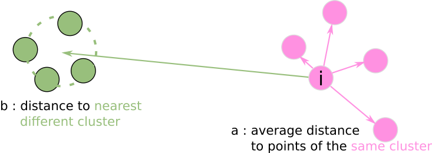
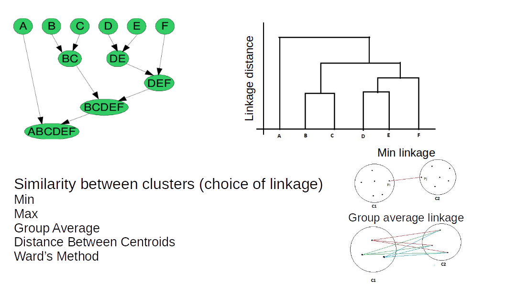

```{r}
library(gplots)
library(ggplot2)
library(recipes)
library(tidyr)
library(umap)
library(ggbiplot)
library(bluster)
library(gridExtra)
library(dendextend)
library(stringr)
```

# Loading the data

## immunogenicity dataset

Same data & preparation code as before.

```{r}
df_im = read.csv('../data/aaf2288-Table-S8.csv')

df_im = df_im %>% 
    rename(MUT_pos  = Position.of.mutation.in.peptide,
        WT_affin = Predicted.affinity.wildtype.peptide..nM.,
        MUT_affin = Predicted.affinity.mutant.peptide..nM.,
        WT_cleav = Predicted.cleavage.probability.wildtype.peptide,
        MUT_cleav = Predicted.cleavage.probability.mutant.peptide,
        WT_stability = Predicted.stability.wildtype.peptide..hours.,
        MUT_stability = Predicted.stability.mutant.peptide..hours.,
        WT_read_perc = X..of.mutant.reads,
        RNA_expr = RNA.expression.of.gene..FPKM.,
        CD8_response = CD8..T.cell.response.induced.in.healthy.donor..Tested.Observed ) %>%
    mutate(CD8_response=CD8_response %>% recode_values(
                               '' ~ 'na',
                               'YES / NO' ~ 'neg',
                               'YES / YES' ~ 'pos'
    )) %>%
    select( MUT_pos,WT_affin,MUT_affin,WT_cleav,MUT_cleav,WT_stability,MUT_stability,WT_read_perc,RNA_expr,CD8_response, Mutant.peptide )

## PCA
im_recipe = recipe( df_im , CD8_response ~ . ) %>%
      update_role(Mutant.peptide, new_role = "ID") %>% # variable kept in the data but not in the models
    step_log( RNA_expr, WT_affin, MUT_affin , base = 10 ) %>% # log-transform for some features
    step_normalize( all_numeric_predictors()) %>% ## equivalent to step_center() %>% step_scale()
    step_pca( all_predictors(),  num_comp = 10,
              options = list(retx=TRUE) ) %>%
    prep()

df_im_pca = im_recipe %>% bake( df_im )


## UMAP
im_umap = umap( df_im_pca %>% select(starts_with("PC")) , 
                random_state = 2026,
                n_neighbors = 50)

```

## iris dataset

The well-known "iris" dataset that comes within base R, with 4 different floral measurements for 3 species of iris.

```{r}
data(iris)
iris %>% head()
```
```{r}
iris_recipe = recipe( iris , Species ~ . ) %>%
    step_normalize( all_numeric_predictors() ) %>%
    step_pca( all_numeric_predictors() , options = list(retx = TRUE) ) %>%
    prep()

iris_pca = iris_recipe %>% bake( iris )

prcomp_obj = iris_recipe$steps[[2]]$res

ggbiplot(prcomp_obj, 
         groups = iris$Species,
         choices = c(1,2),
         alpha = 0.8,
         varname.size = 3,
         varname.color = 'black',
         var.factor = .5
         )
```


# Clustering 


Clustering is an unsupervised method that serves many purposes:

  * Pattern detection: discover hidden patterns in your data
  * Compression: replace all cluster members by one representative
  * Denoising: replace noisy feature vectors by the cluster consensus vector
  * Dimensionality reduction: replace a feature vector by cluster similarities
  * Outlier detection: detect samples which sit far away from cluster centers
  * ...


If you find some cluster-like structures in your data that correspond to one of your hypotheses then you're on a good track! 
Often you need to carefully clean and normalize your data to discover these structures. 

Be aware that clustering algorithms are not magical techniques that give you a straight answer: you will need to find good hyperparameters for the model to work, and your expertise and understanding of the data is crucial to obtain good results.

More-over, you will see that the concept of **cluster** itself can have changing definition depending on the data and objective.


## K-means clustering

The [K-means](https://rdrr.io/r/stats/kmeans.html) algorithm is a widely used clustering algorithm. 


[Allison Horst K-mean visual explaination](https://allisonhorst.com/k-means-clustering)

The K-means algorithm aims at finding the right partition of the data ($\pmb{X_1},...,\pmb{X_n}$) into $K$ clusters $\pmb{C}={C_1,...,C_K}$ so that the within cluster sum of squares (inertia) is minimized:

$\pmb{C}=argmin_{\pmb{C}} \sum_{k=1}^{K}\sum_{i \in C_k}||\pmb{X_i}-\pmb{\mu_k}||^2$

$\pmb{\mu_k}=\frac{1}{|C_k|}\sum_{i \in C_k}\pmb{X_i}$

K-means requires the number of clusters as input. The greedy algorithm consists of 3 main parts:

 1. Choose $K$ points from $\pmb{X_i}$ as initial values for $\pmb{\mu_k}$. These initial points should be spread out over the dataset
 2. Compute the centroids $\pmb{\mu_k}=\frac{1}{|C_k|}\sum_{i \in C_k}\pmb{X_i}$
 3. Assignment step: assign each $\pmb{X_i}$ to a cluster $C_k=argmin_{C_k} ||\pmb{X_i}-\pmb{\mu_k}||^2$
 4. Update step: recalculate $\pmb{\mu_k}=\frac{1}{|C_k|}\sum_{i \in C_k}\pmb{X_i}$
 5. Iterate steps 3 & 4 until convergence


```{r}
iris_km = kmeans( iris_pca %>% select(starts_with("PC")) , centers = 3 )
iris_km
```

 * **cluster** indicates the cluster to which each point is allocated
 * **centers** matrix of cluster centers
 * **totss** total sum of squares
 * **withinss** within-cluster sum of squares, one component per cluster
 * **tot.withinss** total within-cluster sum of squares, i.e. sum(withinss)
 * **betweenss** between-cluster sum of squares, i.e. totss-tot.withinss
 * **size** the number of points in each cluster
 * **iter** number of iterations
 * **ifault**	indicator of a possible algorithm problem – for experts.

```{r}
ggplot(iris_pca , aes( x=PC1 , y=PC2 , 
                       col = as.factor(iris_km$cluster) , 
                       pch = Species)) +
    geom_point()
```
```{r}
table( iris$Species , iris_km$cluster )
```


K-means is a greedy algorithm, i.e. it will only find a local minimum of the inertia. 
Therefore it is good practice to run the algorithm several times with different initialization.

In R, the [Kmeans implementation](https://rdrr.io/r/stats/kmeans.html) uses a `nstart` parameter to launch the algorithm with different initializations (the default is 1).

```{r}
iris_km = kmeans( iris_pca %>% select(starts_with("PC")) , centers = 3,
                  nstart = 10 )
ggplot(iris_pca , aes( x=PC1 , y=PC2 , 
                       col = as.factor(iris_km$cluster) , 
                       pch = Species)) +
    geom_point()
```

For this simple dataset, this is unlikely to matter much, but it is nevertheless good practice to have several starts.


**Important remarks:**

 - KMeans is based on a concept of distances : your **data needs to be properly scaled**
 - KMeans creates, by construction, **globular clusters**
 - KMeans results depends on parameter **K**


What values should we give to parameter K?


```{r}
iris_pca %>% 
    mutate( km2 = kmeans( iris_pca %>% select(starts_with("PC")) , 
                                   centers = 2,
                                   nstart = 10 )$cluster ) %>%
    mutate( km3 = kmeans( iris_pca %>% select(starts_with("PC")) , 
                                   centers = 3,
                                   nstart = 10 )$cluster ) %>%
    mutate( km5 = kmeans( iris_pca %>% select(starts_with("PC")) , 
                                   centers = 5,
                                   nstart = 10 )$cluster ) %>%
    pivot_longer( cols = km2:km5, names_to = 'KM', values_to = 'cluster') %>%
    mutate( cluster = as.factor(cluster) ) %>%
    ggplot(aes(x = PC1, y = PC2)) +
    geom_point(aes(color = cluster), alpha = 0.8) + 
    facet_wrap(~ KM)

```

We see that the number of clusters defines the k-means clustering outcome. It is difficult to say by looking at the t-SNE projections, whether 2 or 3 clusters better reveal underlying patterns of the data. 

There, we can compare the clustering proposed by different values of K with some of the clustering quality metrics.
 
---

### Adjusted Rand Index

> For the metrics, we turn to the [bluster](https://www.bioconductor.org/packages/release/bioc/html/bluster.html) packages which offers good diagnostic and wrapper functions for clustering.

In one case, we could **use known categories**, like the species for the iris example, when they exists AND when we think they should form meaningful clusters.

An eample of such metric is the **Adjusted Rand Index** (ARI) which computes the similarity between two cluster assignments.

The unadjusted version is computed with:
 * $s$ : the number of pairs of objects which have the same cluster in clustering 1 and the same in clustering 2 too
 * $d$ : the number of pairs of objects which have different clusters in clustering 1 and different clusters in clustering 2 too
 * $p$ : the total number of possible pairs of objects

$$RI = \frac{s+d}{p}$$

The "Adjusted" version corresponds to a normalization that ensures that random clusterings give a value close to 0 and perfectly concordant clusterings a value of 1.


```{r}
## ARI example
labels_true = c( 0, 0 , 1 , 1 , 1 , 0 , 0 )
labels_pred = c( 0, 1 , 0 , 1 , 1 , 0 , 0 ) 

##   possible pairs of objects : (0,1) (0,2) (1,2)  ...
## in clustering 1             :   s     d     d    ...
## in clustering 2             :   d     s     d    ...
##                                             ^ this one is different in both clusterings 

## pairwiseRand from bluster
print(paste( "              RI:", pairwiseRand(labels_true, labels_pred , mode= 'index',
                                               adjusted = FALSE)))
print(paste( "             ARI:", pairwiseRand(labels_true, labels_pred, mode= 'index')))
```

### Silhouette score

Another way, in the more common case where we do not know the categories in advances would be to use some metric which **computes how each cluster is cohesive and well separated from the others**.

Here we will use the **silhouette score** metric.

The **silhouette score** is **calculated for each point** using 

* the mean intra-cluster distance : $a$
* the distance between a sample and the nearest cluster that the sample is not a part of : $b$



The Silhouette score for a single point is $SC=\frac{(b-a)}{max(a,b)}$

$SC$ is always between -1 (bad clustering) and 1 (perfect clustering).

So the **silhouette score should be maximized.**

> Warning : some score should be maximized and some other minimized. Be sure you know which one it should be before interpreting your results!

The `bluster` function `approxSilhouette` returns the Silhouette score of all samples for a given clustering result. 

The value is actually approximated in order to keep the computation tractable.


--- 

Let's try to apply this logic to the iris data-set.


```{r}
km3 = kmeans( iris_pca %>% select(starts_with("PC")) , 
              centers = 3,
              nstart = 10 )

```

```{r}
## ARI
pairwiseRand(iris$Species, km3$cluster, mode= 'index')
```

```{r}
sil = approxSilhouette( iris_pca %>% select(starts_with("PC")) ,
                        km3$cluster )
sil
```

 * `cluster`: associated cluster
 * `other`: closest cluster that is not the associated cluster
 * `width`: silhouette for this point

Here we have the silhouette of each point. 

We can actually look at the average silhouette to get a score for the whole clustering, or look at individual values (which could help flag outliers, unstable clusters, ...)

```{r}
ggplot( sil , aes( x = as.factor( cluster ) , y = width ) ) + geom_boxplot()
```

Here we can see that most points have a silhouette > 0 (which means the point is on average closest to its own cluster than another).


```{r}
## average silhouette score
sil$width %>% mean()
```

---

**How does this helps us decide on a good value for K?**

We can cluster according to different parameters, compute the score for each, and compare.

```{r}
## bluster clusterSweep helps us go through a number of clustering parameters
km_sweep = clusterSweep( iris_pca %>% select(starts_with("PC")) ,
                                             BLUSPARAM = KmeansParam(centers = 3,
                                                                     nstart = 3),
                                             centers = 2:9 )
km_sweep
```

We have all the clusterings in the resulting object:
```{r}
km_sweep$clusters
```


```{r}
## compute silhouette
sil <- vapply(as.list(km_sweep$clusters), 
              function(clustering) mean(approxSilhouette(iris_pca %>% select(starts_with("PC")),
                                                clustering)$width), 0)

## compute ARIs
ARIs <- vapply(as.list(km_sweep$clusters), 
              function(clustering) pairwiseRand(iris$Species, 
                                                clustering, mode= 'index'), 0)

scores = data.frame( K = 2:9,
            silhouette = sil, 
            ARI = ARIs)
scores
```


```{r}
p1 <- ggplot( scores , aes( x = K, y = silhouette ) ) + geom_line()
p2 <- ggplot( scores , aes( x = K, y = ARI ) ) + geom_line()
grid.arrange(p1, p2, ncol=2)
```

**Question:** What is the best K according to each metric ? Which one would you choose ?

remember, the data looks like this:

```{r}
ggplot( iris_pca , aes( x = PC1 , y = PC2 ) ) + geom_point()
#ggplot( iris_pca , aes( x = PC1 , y = PC2 , col = Species ) ) %>% geom_point()
```

### Micro-exercise: Kmeans

Perform a kmean clustering on the AML data. What is the best number of clusters ? Does it looks like it correlates with the auc column ?


> **NOTE:** we do not have a reference clustering here, so compute only he silhouette and not the ARI

```{r}
df_aml = read.csv('../data/gene_drug_sens.csv' , row.names = 1)
X_aml = df_aml %>% select( c('auc' , colnames(df_aml)[9:ncol(df_aml)] ) )

aml_recipe = recipe( X_aml , auc ~ . ) %>% # set AUC as response
  step_normalize( all_numeric_predictors() ) %>% 
  step_pca( all_predictors(),  num_comp = 17,
            options = list(retx=TRUE) ) %>%
  prep()

df_aml_pca = aml_recipe %>% bake( X_aml )
df_aml_pca %>% head()
```

```{r}
## your Kmean code here

```


Solution in `solutions/solution_Kmean.R`


## Hierarchical clustering

Hierarchical clustering is an algorithms that iteratively merges data points or groups of data points. It starts with $N$ clusters, one cluster per data point. It first calculates the pairwise distances between all clusters. It then selects the two closests clusters and merges them into a new cluster. Next it recalculates the distances between the newly formed cluster and the remaining clusters. It repeats these steps until a specified number of clusters is reached or until all distances between clusters are larger than a specified threshold.



Since this type of algorithm requires pairwise distance calculations and does this up to $N$ times until all clusters are merged, the complexity of the algorithms is $N^3$. This is often too slow for large datasets. The algorithms can be accelerated by speeding up distance calculations or initialize the clusters with a coarse k-means clustering.

The main advantage of the algorithm is the visualization of the results as dendrograms and the easy interpretability of the results.

`hclust` proposes a number of options regarding how to compute the similarity between clusters, the `method` argument, whose main options are:

* `ward.D2` minimizes the variance of the clusters being merged.
* `average` uses the average of the distances of each observation of the two sets.
* `complete` or maximum linkage uses the maximum distance between all observations of the two sets.
* `single` uses the minimum of the distances between all observations of the two sets.


Let's take a moment to think on the implication these choice of linkage could have when clustering.


```{r}
df_moons = read.csv( "../data/moons.csv" )
df_moons$y = as.factor(df_moons$y)
ggplot( df_moons , aes( x = x1 , y = x2 , col = y ) ) + geom_point()
```

```{r}
## The first step is to compute a distance matrix between the observations
## with use dist() here, but you can use your own function
d = dist( df_moons[, c('x1','x2') ] )

## hierarchical clustering for different
h_complete = hclust(d, method = 'complete')
h_single   = hclust(d, method = 'single')
h_average  = hclust(d, method = 'average')
```

For plotting the dendrogram, we will use [dendextend](https://cran.r-project.org/web/packages/dendextend/vignettes/Cluster_Analysis.html)


```{r}

par(mfrow=c(1,3))

dend <- as.dendrogram(h_single)
labels_colors(dend) <- c('salmon','cornflowerblue')[ df_moons$y[order.dendrogram(dend)] ]
plot(dend , main="single")


dend <- as.dendrogram(h_complete)
labels_colors(dend) <- c('salmon','cornflowerblue')[ df_moons$y[order.dendrogram(dend)] ]
plot(dend , main="complete")

dend <- as.dendrogram(h_average)
labels_colors(dend) <- c('salmon','cornflowerblue')[ df_moons$y[order.dendrogram(dend)] ]
plot(dend , main="average")


```

```{r}
## we can get the actual clusters with cutree
cluster = cutree( h_complete , k = 2 )

ggplot( df_moons , aes( x = x1 , y = x2 , col = as.factor(cluster) ) ) + geom_point()
```

---

let's apply this on the iris dataset

```{r}
d = dist( iris_pca %>% select( starts_with("PC") ) )

## hierarchical clustering for different
h_iris = hclust(d, method = 'ward.D2')
cluster = cutree( h_iris , k = 3 )

dend <- as.dendrogram(h_iris)

# Color the branches based on the clusters:
dend <- color_branches(dend, k=3)

labels_colors(dend) <- c('darkgreen','pink','orange')[ iris_pca$Species[order.dendrogram(dend)] ]

# We shall add the flower type to the labels:
labels(dend) <- as.character(iris_pca$Species[order.dendrogram(dend)])

# reduce the size of the labels:
dend <- set(dend, "labels_cex", 0.5)
# And plot:

plot(dend, 
     main = "Clustered Iris data set
     (the labels give the true flower species)")
```

We can apply a similar cluster sweep. `bluster` wraps the different steps (distance computation, `cutree`):

```{r}
## bluster clusterSweep helps us go through a number of clustering parameters
km_sweep = clusterSweep( iris_pca %>% select(starts_with("PC")) ,
                         BLUSPARAM = HclustParam(
                             method = 'single',
                             dist.fun = dist,
                             cut.params = list( k = 3 )
                             ),
                         method = c( 'single' , 'average' , 'complete'  ),
                         cut.params = list( k = 2:9 )
)
                         

```
```{r}
## compute silhouette
sil <- vapply(as.list(km_sweep$clusters), 
              function(clustering) mean(approxSilhouette(iris_pca %>% select(starts_with("PC")),
                                                clustering)$width), 0)

## compute ARIs
ARIs <- vapply(as.list(km_sweep$clusters), 
              function(clustering) pairwiseRand(iris$Species, 
                                                clustering, mode= 'index'), 0)

scores = data.frame( 
    K = unlist( km_sweep$parameters$cut.params ),
    method = km_sweep$parameters$method,
    silhouette = sil, 
    ARI = ARIs
    )


p1 <- ggplot( scores , aes( x = K, y = silhouette, col = method ) ) + geom_line()
p2 <- ggplot( scores , aes( x = K, y = ARI, col = method ) ) + geom_line()
grid.arrange(p1, p2, ncol=2)
```

---

Last but not least, hierarchical clustering is very common in **heatmaps**:


```{r}
heatmap.2( as.matrix( iris[,-5] ) , cexCol = 1 )
```


## What is the best method for clustering ? 

As you surely suspect by now, there is no perfect method. 
Each algorithm makes different assumptions about the structure of your data and will thus behave well or bad depending on howyour data is actually structured.

Let's demonstrate by displaying how different algorithm perform on different dataset (example adapted from the [sklearn documentation](https://scikit-learn.org/stable/auto_examples/cluster/plot_cluster_comparison.html)):


## Exercise: EDA and Clustering - single cell RNAseq data 

Data from: [Li H, Courtois ET, Sengupta D, Tan Y et al. Reference component analysis of single-cell transcriptomes elucidates cellular heterogeneity in human colorectal tumors. Nat Genet 2017 May;49(5):708-718. PMID: 28319088](https://pubmed.ncbi.nlm.nih.gov/28319088/)

The data consists in normalized expression data (log10 RPKM) of 561 cells from 7 different human cell lines.

For convenience, the cell lines have been associated to colors.

In the data table:

 * columns are genes
 * rows are cells
 
You can presume that the data has already been properly normalized, scaled, and imputed.
 
**code for reading the data:**


```{r}
## reading the data
X_rpkm = read.csv( "../data/GSE81861_log10_RPKM.filtered.csv" , row.names = 1 )
X_rpkm %>% head()
```


```{r}
dim(X_rpkm) ## 561 cells, 7980 genes
```

```{r}
index_colors = str_split_i( str_extract( row.names( X_rpkm ) , "_[^_]+$" ) , '_' , 2 )
table( index_colors )
```

Instructions:

 1. perform a PCA and visualize the results, only keep 500 components
 2. try to cluster the cells using K-Means or Hierarchical clustering. 
     Try several parameter values and evaluate your clustering with a metric.
 3. try the same thing, but use only the 50 first PCA components. Do you get better results?

---

 1. perform a PCA and visualize the results, only keep 500 components

> *Hint:* use `step_pca` `num_comp` argument

```{r}
## you PCA code here
```


 2. try to cluster the cells using K-Means or Hierarchical clustering. 
     Try several parameter values and evaluate your clustering with a metric.
    


```{r}
## your clustering code here

```

 3. try the same thing, but use only the 50 first PCA components. Do you get better results?
 
 > *Hint:* use `step_pca` `num_comp` argument


```{r}

```

The solutions is in the file `solutions/solution_RPKM.R`
