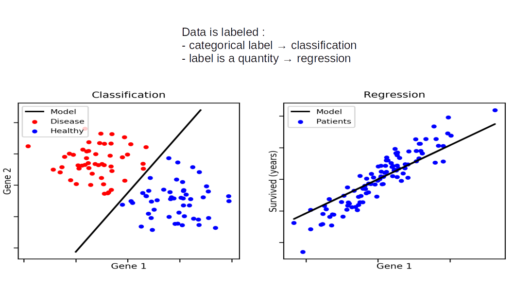
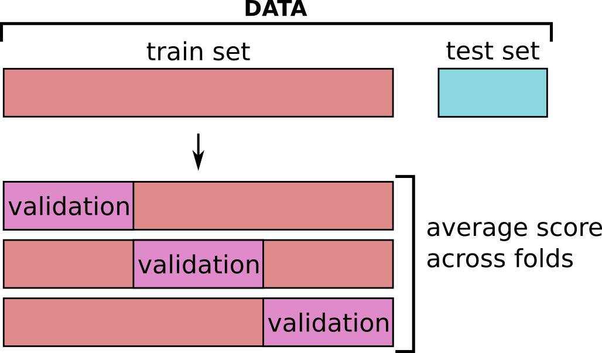

```{r setup, include=FALSE}
knitr::opts_chunk$set(echo = TRUE)
```

```{r}
library(tidyr)
library(dplyr)
library(ggplot2)
library(gridExtra)

library(tidymodels)
```

In this chapter, we will use a simple regression case to introduce some **core concepts of Supervised Learning and Machine Learning**.

Supervised Learning considers tasks where we want to predict a predefined target. If the target is categorical, it is a **classification task**. If the target is continuous, it is a **regression task**.



-----

Regression and classification use different models and optimize different metrics, but in Machine Learning they also share many common practices and concerns.

The machine learning paradigm emphasizes the importance of building a model that will be good **not only on the data it has been trained on, but also on new data**. In other words, we want a model that can be **generalized to new data**.

# Motivating example

[Acharjee et al.2016](https://bmcbioinformatics.biomedcentral.com/articles/10.1186/s12859-016-1043-4) explore several -omic datasets, using them to predict and gain knowledge on various phenotypic traits in potatoes.

Here, we will concentrate on their transcriptomics dataset and the phenotypic trait of the potato coloration.

We have pre-selected and normalized the 200 most promising genes (out of \~15 000).

```{r}
file_metadata = "../data/potato_data.phenotypic.csv"
file_data = "../data/potato_data.transcriptomic.top200norm.csv"

df = read.csv( file_metadata , row.names = 1 )
dfTT = read.csv( file_data , row.names = 1 )


dfTT[ row.names(df) , "Flesh.Colour"  ] <- df[ , "Flesh.Colour"  ]  

head(cbind(dfTT[,1:5],dfTT[,"Flesh.Colour",drop=FALSE])) # view small section
```

For the sake of our story, we will imagine that out of the 86 potatoes in the data, we have only 73 when performing the initial sequencing. We'll put aside the rest for later.

```{r}
i1 = row.names(df)[1:73]
i2 = row.names(df)[74:nrow( df )]
```

```{r}
X = dfTT[i1 , ]
X[,1:5] %>% head()
```

```{r}
X$Flesh.Colour %>% summary()
```

```{r}
ggplot(dfTT , aes(x=Flesh.Colour) ) + geom_histogram()
```

## approach 1: a simple linear regression

We will be modelling the potato flesh color using a simple [linear model](https://en.wikipedia.org/wiki/Linear_model), where we would write the equation of the flesh color something like:

$$flesh color = \beta_1 * E1 + \beta_2 * E2 + ... + \beta_n * En $$

Where $Ex$ is the expression level of gene $x$, and $\beta_x$ is the associated coefficient, which describes how much the expression of gene $x$ contributes to the flesh color prediction.

> It is very likely that you have already seen and manipulated linear models previously, and we are not going to develop them much further here. But in case this is the first time you meet them, or you just want a refresher, here is a [jupyter notebook on linear models](https://github.com/sib-swiss/statistics-and-machine-learning-training/blob/main/01_regression_Least_Square.ipynb), from one of our other courses ;-)

------------------------------------------------------------------------

Let's fit a simple linear model with our gene expression values, and see what happens.

For this, we will introduce some syntax elements from [parsnip](https://parsnip.tidymodels.org/) and [yardstick](https://yardstick.tidymodels.org/).

---

With [parsnip](https://parsnip.tidymodels.org/) you instantiate a model from a broad family, and set its `engine`, which represents the specific implementation you want.

For example: `linear_reg( engine = 'lm' )` or `linear_reg( engine = 'stan' )` are both linear models, the first uses `lm()` while the second uses the Bayesian methods of the `stan` package.

Then this model needs to be `fit( <formula> , <data> )` (like the `prep()` of recipes)

After that, you can use `predict()` with some data to get the prediction of your model.

> A very useful resource: [searchable list of parsnip models](https://www.tidymodels.org/find/parsnip/)

<!-- TBD: why use parsnip? -->

---

[Yardstick](https://yardstick.tidymodels.org/) is about computing how well your models are doing: it implements all sorts of metrics, both for classification and regression.

The score functions of yardstick usually come in two forms: 

* the base form (e.g., `rsq`) expects a dataframe with specific columns (which is a standard output of tidymodels workflows)
* the vector form (e.g., `rsq_vec`) expects 2 vectors: the truth, and the prediction

<!-- TBD: why use yardstick? -->

---

```{r}

lm_fit <- linear_reg() %>% 
  fit(Flesh.Colour ~ . , data = X)


pred = ( lm_fit %>% predict( new_data = X ) )$.pred

range(residuals(lm_fit$fit)) # range(X$Flesh.Colour - pred) # residuals

print(paste( "R-squared score: " ,
             rsq_vec(truth = X$Flesh.Colour, estimate = pred ) ))

print(paste( "Root mean squared error: " ,
             rmse_vec(truth = X$Flesh.Colour, estimate = pred ) ))

```
<!-- I get a warning here -->
**Wow!!** this is a perfect fit.


But if you know anything about biology, or data analysis, then you likely suspect something wrong is happening.

Indeed, at the moment, our claim is that our model can predict flesh color perfectly (RMSE=0.0) from the normalized expression of these 200 genes.

But, say we now have some colleagues who come to us with some newly sequenced potato data:

```{r}
Xnew = dfTT[i2,]

pred_new = ( lm_fit %>% predict( new_data = Xnew ) )$.pred

print(paste( "R-squared score: " ,
             rsq_vec(truth = Xnew$Flesh.Colour, estimate = pred_new ) ))

print(paste( "Root mean squared error: " ,
             rmse_vec(truth = Xnew$Flesh.Colour, estimate = pred_new ) ))
```

```{r}
tmp = X %>% bind_rows( Xnew )
tmp$set = ifelse( row.names(tmp) %in% i1 , "train" , "new" )
tmp <- tmp %>% bind_cols( lm_fit %>% predict( new_data = tmp ) )

ggplot(tmp , aes(x=Flesh.Colour , y = .pred , colour = set )) +
  geom_point()
```

As expected, the performance on the new data is not as good as with the data we used to train the model.

We have **overfitted** the data.

------------------------------------------------------------------------

Here we could still use the model that we have created, but we would agree that reporting the perfect performance we had with our training data would be misleading.

To honestly report the performance of our model, we measure it on a **set of data that has not been used at all to train it: the *test set*.**

To that end, we typically begin by dividing our data into :

-   **train** set : find the best model
-   **test** set : give an honest evaluation of how the model perform on completely new data.


## approach 2: adding regularization and validation set

In the case of a Least Square fit, the function you are minimizing (the "cost function") looks like:

$$\sum_i (y_i-y\_pred_i))^2$$

i.e. the sum of squared differences between the observations and the predictions of your model.

And remember that our model is written in the following way:

$$y\_pred_i = \beta_1 * X1_{i} + \beta_2 * X2_{i} + ... + \beta_n * Xn_{i} $$

------------------------------------------------------------------------

**Regularization** is a way to reduce overfitting, and in the case of the linear model, we apply it by adding to this function a **penalization term which depends on coefficient weights** (*ie* on the $\beta_x$).

In brief, the larger the coefficient, the higher the penalization. This way, only coefficients which bring more fit than penalization will be kept.

> Note : we report here the formulas used in `scikit-learn` functions. Other libraries may have a different parameterizations, but the concepts stay the same.

* **l1 regularization** (Lasso): $\frac{1}{2n}\sum_i (y_i-f(\pmb X_i,\pmb{\beta}))^2 + \alpha\sum_{j}|\beta_{j}|$, $\alpha$ being the weight that you put on the regularization

* **l2 regularization** (Ridge): $\sum_i (y_i-f(\pmb X_i,\pmb{\beta}))^2 + \alpha\sum_{j}\beta_{j}^{2}$

* **elasticnet**: $\frac{1}{2n}\sum_i (y_i-f(\pmb X_i,\pmb{\beta}))^2 + \alpha\sum_{j}(\rho|\beta_{j}|+\frac{(1-\rho)}{2}\beta_{j}^{2})$, where $\rho$ controls where the regularisation lands between l1 and l2.

For a deeper understanding of those notions, you may look at [this datacamp tutorial](https://www.datacamp.com/community/tutorials/tutorial-ridge-lasso-elastic-net).


> NB: Regularization generalize to maximum likelihood contexts as well.

For all of these, you can see that **parameter** $\alpha$ controls the regularization "strength".

* A small $\alpha$ will give you almost the same model as before.

* A large $\alpha$ will give you a model where only a few coefficients are allowed to have a significant impact on the prediction.

Let's try this on our data:

```{r}
l1_ratio = 1.0

RSQ = c()
COEFS = NULL
log10_penalties = seq(-2,1,length.out=50)
for( log10_penalty in  log10_penalties){
  glmn_fit <- 
    linear_reg(penalty = 10**log10_penalty, 
               mixture = l1_ratio) %>% 
    set_engine("glmnet") %>%
    fit(Flesh.Colour ~ . , data = X)

  pred = ( glmn_fit %>% predict( new_data = X ) )$.pred

  RSQ = c(RSQ , rsq_vec(truth = X$Flesh.Colour, estimate = pred ) )
  
  COEFS = bind_rows( COEFS,  tidy( glmn_fit ) %>%filter(term != "(Intercept)") )
}
  

```

```{r fig.width=10, fig.height=5}
p1 = ggplot( data.frame( RSQ=RSQ , log10_penalty = log10_penalties ) , aes(x=log10_penalty,y=RSQ))+geom_line()
p2 = ggplot( COEFS , aes(x=penalty,y=estimate, group = term, color=term)) + 
  geom_line(show.legend = FALSE) + scale_x_log10() 
grid.arrange(p1,p2, nrow=1)
```
<!-- TBD: I get warnings when running this. -->
On the left subplot you see how the R-squared score changes with $log10(\alpha)$.


 * **High $R^2$ at low $\alpha$**: at lower values of $log10(\alpha)$ (left side of the plot), the R-squared score is high, indicating that the model fits the data well. This is because the regularization is weak, allowing more features to contribute to the model - and likely overfit.
 * **Sharp Drop in $R^2$**: as $log10(\alpha)$ increases, the R-squared score drops sharply. This indicates that stronger regularization (higher alpha values) leads to a simpler model with fewer features, which may not capture the data’s variance as well.
 * **$R^2 = 0$ at high $\alpha$**: at higher values of $log10(\alpha)$ (right side of the plot), the R-squared score is 0, indicating that regularization is so strong that no coefficients are contributing to the predictions (*ie*, their values are all at 0) - basically, a null model.


The right subplot confirms this interpretation, as it shows the coefficients values for each of level of $\alpha$.

 * Each line represents the path of a coefficient for a specific feature (here a gene) as $\alpha$ varies.
 * As log-alpha increases, many **coefficients shrink towards zero**. This is the effect of L1 regularization, which penalizes the absolute size of the coefficients, leading to sparse models where many coefficients become exactly zero.
 * Features with coefficients that shrink to zero first are less important for the model. Features whose **coefficients remain non-zero for higher values of log-alpha are more important for the model**.


---


**Micro-exercise:** adapt the code above to generate this plot with an l2 penalty and make the penalty go from 100 to 10'000 . How do you interpret the difference?

```{r}
## your code here


```

---

This is great, but how do we choose which level of regularization we want ?

It is a general rule that **as you decrease $\alpha$, the $R^2$ on the data used for the fit increases**, i.e. you risk overfitting.

Consequently, we cannot choose the value of $\alpha$ parameter from the fitted data alone; we call such a parameter a **hyper-parameter**.

**Question:** are there any other hyper-parameters at this point?

---


In order to find the optimal value of an hyper-parameter, we can separate our training data into:

 * a **training set** : used to fit the model;
 * a **validation set** : used to evaluate how our model performs on new data (generalises).


```{r}
## to split our training data into training and validation sets,
## we will use initial_split() from package rsample:
split <- initial_split(X, prop = 0.7)

X_train <- training(split)
X_valid <- testing(split)

l1_ratio = 1.0

RSQ_train = c()
RSQ_valid = c()

log10_penalties = seq(-2,1,length.out=50)

for( log10_penalty in  log10_penalties){
  glmn_fit <- 
    linear_reg(penalty = 10**log10_penalty, 
               mixture = l1_ratio) %>% 
    set_engine("glmnet") %>%
    fit(Flesh.Colour ~ . , data = X_train)

  pred = ( glmn_fit %>% predict( new_data = X_train ) )$.pred
  RSQ_train = c(RSQ_train , rsq_vec(truth = X_train$Flesh.Colour, estimate = pred ) )
  
  pred = ( glmn_fit %>% predict( new_data = X_valid ) )$.pred
  RSQ_valid = c(RSQ_valid , rsq_vec(truth = X_valid$Flesh.Colour, estimate = pred ) )

}
  

dfr2 = data.frame( Rsquare= c( RSQ_train , RSQ_valid ) , 
                   log10_penalty = c( log10_penalties , log10_penalties ),
                   set = rep(c('train','valid'), each=length(log10_penalties)) )

p = ggplot( dfr2 , aes(x=log10_penalty,y=Rsquare,colour = set))+geom_line()

## best value according to validation set:
best_penalty = dfr2 %>% filter( set=='valid' ) %>% slice_max(Rsquare,n=1)
p + geom_vline(xintercept = best_penalty$log10_penalty ) +
  ggtitle( paste("best log10 penalty:", best_penalty$log10_penalty ) )
```

So now, with the help of a validation set, we can clearly see the phases :

 * **underfitting** : for high $\alpha$, the performance is low for both the training and the validation sets
 * **overfitting** : for low $\alpha$, the performance is high for the training set, and low for the validation set

We want the equilibrium point between the two, where performance is ideal for the validation set.

**Problem :** if you run the code above several times, you will see that the optimal point varies due to the random assignation to training or validation set.

There exists a myriad of possible strategies to deal with this problem, such as repeating the above many times and taking the average of the results.

> Also note that this problem gets less important as the validation set size increases.

------------------------------------------------------------------------

<br>

Anyhow, on top of our earlier regression model, we have added :

 - a **hyper-parameter**, $\alpha$, the strength of the regularization term
 - a **validation strategy** for our model in order to avoid overfitting

<br>

That's it, we are now in the world of Machine Learning!

But before we go any further, let's see how this modified model performs on the test data:

```{r}
## fitting model
glmn_fit <- 
  linear_reg(penalty = 10**best_penalty$log10_penalty, 
             mixture = l1_ratio) %>% 
  set_engine("glmnet") %>%
  fit(Flesh.Colour ~ . , data = X)

## grouping and predicting 
tmp = X %>% bind_rows( Xnew )
tmp$set = ifelse( row.names(tmp) %in% i1 , "train" , "test" )
tmp <- tmp %>% bind_cols( glmn_fit %>% predict( new_data = tmp ) )

## computing metric
tmp %>% group_by(set)  %>% rsq( Flesh.Colour , .pred )
tmp %>% group_by(set)  %>% rmse( Flesh.Colour , .pred )

## plotting
ggplot(tmp , aes(x=Flesh.Colour , y = .pred , colour = set )) +
  geom_point()
```

## approach 3: k-fold cross-validation

In the previous approach, we split our data into a training set and a validation set.

This approach works well if you have enough data for your validation set to be representative.

Often, we unfortunately do not have enough data for this.

Indeed, we have seen that if we run the code above several times, the optimal point varies due to the random assignation to training or validation set.

**K-fold cross validation** is one of the most common strategies to try to mitigate this randomness with a limited amount of data.


<!-- TBD: this image is incorrect AFAICT -->

In k-fold cross-validation:

1.  the data is split in $k$ pieces, called folds.
2.  $k$ models are trained for each hyper-parameter value combination: each time, a different fold is used for validation (and the remaining $k-1$ folds used for training).
3.  the average performance is computed across all folds : this is the **cross-validated performance**.

------------------------------------------------------------------------

We are going to do a simple k-fold manually once, to explore a bit how it works, but in practice you will discover that it is mostly automatized with some of tidymodels' recipes and objects.

> NB: tidymodels calls k-fold cross-validation "V-fold". I choose to keep k-fold because this sees more usage in Machine Learning communities (while V-fold sees more usage in statistics communities).

```{r}
set.seed(1435)
folds <- vfold_cv(X, v = 5)
folds
```

In order to put together model, data, recipes, and cross-validation scheme, we will use a *workflow*.

```{r}
## we need to organize the model as a workflow
LR_wf <- 
  workflow() %>%
  add_model( 
    linear_reg(penalty = 10**best_penalty$log10_penalty, ## for now, using a fixed value
               mixture = l1_ratio) %>% set_engine("glmnet") 
             ) %>%
  add_formula( Flesh.Colour ~ . )

LR_fit_res = LR_wf %>% fit_resamples(folds)

collect_metrics(LR_fit_res)
```
We can also get the metrics for each fold separately:

```{r}
collect_metrics(LR_fit_res , summarize = FALSE)
```

Now we can adapt this to scan through different penalty strengths. In tidymodels, we tell the workflow we want this by setting the hyper-parameter's initial value to `tune()`, and defining a grid of values to explore:

```{r}

LR_wf <- 
  workflow() %>%
  add_model( 
    linear_reg(penalty = tune(),  ## penalty is set as tune()
               mixture = l1_ratio) %>% set_engine("glmnet") 
             ) %>%
  add_formula( Flesh.Colour ~ . )

## prepare the grid of hyper-parameter values to test:
LR_grid <- grid_regular(penalty(range = c(-2,1) ),
                          levels = 50)
LR_grid %>% head()
```

```{r}
LR_grid$penalty %>% summary()
```

> Alternatively, you can use grid_random to explore random values in a given range.

Here comes the cell which will fit all penalty values for each fold:

```{r}
LR_res <- 
  LR_wf %>% 
  tune_grid(
    resamples = folds,
    grid = LR_grid
    )

LR_metric <- LR_res %>% collect_metrics() 
LR_metric %>% head()
```

```{r}
ggplot( LR_metric %>% filter(.metric == 'rsq'), aes(x = penalty , y=mean)) + 
  geom_line() +
  geom_ribbon(aes(ymin = mean - std_err,
                  ymax = mean + std_err),
              fill = 'gray' , alpha = 0.5) +
  scale_x_log10()
```

`show_best()` will display the top combinations of hyper-parameters (by default it displays the top 5)

```{r}
LR_res %>%
  show_best(metric = "rsq")
```

`select_best()` picks the combination with the best performance


```{r}
best_model <- LR_res %>%
  select_best(metric = "rsq")
best_model
```

---

**micro-exercise**: re-fit a model with the penalty we found and check the performance with the *test* data.

```{r}
## fitting model


### here I am re-using the code from before to compute and display performance on the train and test sets

## grouping and predicting 
tmp = X %>% bind_rows( Xnew )
tmp$set = ifelse( row.names(tmp) %in% i1 , "train" , "test" )
tmp <- tmp %>% bind_cols( glmn_fit %>% predict( new_data = tmp ) )

## computing metric
tmp %>% group_by(set)  %>% rsq( Flesh.Colour , .pred )
tmp %>% group_by(set)  %>% rmse( Flesh.Colour , .pred )

## plotting
ggplot(tmp , aes(x=Flesh.Colour , y = .pred , colour = set )) +
  geom_point()
```
You can realize that now, for each possible value of our hyper-parameter, we fit and evaluate not 1, but $k$ models (here 5).

So, for 200 values of $\alpha$, that means 200x5 = 1000 models to fit and evaluate.

Now, consider that we have other hyper-parameters, such as the type of regularization (L1 or L2),
or how we perform scaling, or whether we consider interactions, etc... and now you understand why Machine Learning can quickly become computationally intensive. 

---

## approach 4: a "classical" ML pipeline 

We will start back from scratch to recapitulate what we've seen and use tidymodel's helpful recipes to solve the potato problem.


We start by splitting our data in a training and a test set:

```{r}
split <- initial_split(dfTT, prop = 0.7)
X_train <- training(split)
X_test  <- testing(split)

print(paste("training set size:",nrow(X_train)))
print(paste("test set size:" ,nrow(X_test)))
```

--- 

Here comes the question : **"What should be my test set size?"** 

There is not a single clear-cut answer to this, and it depends a lots on the nature of your data and on the problem you want to solve.


On one hand, if you have **too few training samples**: your model will have a hard time finding the patterns in the data and will likely have poor performance.

On the other hand, if you have **too few testing samples**: the evaluation of your model will be very imprecise.

The typical thing you will see around is 80% training / 20% testing, or 75% / 25%, **BUT**

Some things to keep in mind :

 * consider the **number of samples** you put in the testing set rather than the proportion
 * you want the test set to be **representative**: how many samples do you need for that?
 * what sort of precision would you like to have on the evaluation of your model?
     You can use [proportion confidence intervals](https://www.statskingdom.com/proportion-confidence-interval-calculator.html) to help you
 * **how hard is your problem?** Some problems just need a lot of data.
 
You can read more on this subject in this [blog post](https://www.r-bloggers.com/2021/01/what-is-a-good-test-set-size/). 

---

Now we'll train a model while optimizing some hyper-parameters.

On top of what we've done before, I add a scaling phase, and test different mixtures of l1 or l2 penalties, using [glmnet](https://parsnip.tidymodels.org/reference/details_linear_reg_glmnet.html).


```{r}
# we add a normalization step, so we need a recipe:
LR_recipe <- recipe( Flesh.Colour ~ . , data = X_train) %>%
  step_normalize(all_predictors())

LR_model <- linear_reg(penalty = tune(),  
                       mixture = tune()) %>% 
  set_engine("glmnet") 

LR_wf <- 
  workflow() %>%
  add_model( LR_model ) %>%
  add_recipe( LR_recipe )

## prepare the grid of hyper-parameter values to test:
LR_grid <- grid_regular(penalty(range = c(-2,4) ),
                        mixture(),
                          levels = 10) ## 10 levels per hyper-parameter

## Cross-Validation setup
folds <- vfold_cv(X_train, v = 5)


LR_res <- 
  LR_wf %>% 
  tune_grid(
    resamples = folds,
    grid = LR_grid,
    metrics = metric_set( rsq, mae )
    )
```

```{r}
LR_metrics <- LR_res %>% collect_metrics() %>% filter(.metric == "mae")
ggplot(LR_metrics, aes( x= penalty, y=mixture, fill= mean)) + 
  geom_tile() + scale_x_log10() + scale_fill_distiller("spectral")
```

```{r}
LR_res %>% 
  show_best(metric = "rsq", n = 5)
```

```{r}
best_model <- LR_res %>% select_best(metric = "rsq")
best_model
```

Then we use `finalize_workflow` to apply the best hyper-parameter configuration.

```{r}
final_wf <- 
  LR_wf %>% 
  finalize_workflow(best_model)

final_wf
```

```{r}
final_fit <- 
  final_wf %>%
  last_fit(split) 

final_fit %>%
  collect_metrics()
```

```{r}
test_predictions = final_fit %>% collect_predictions()
ggplot(test_predictions , aes(x=Flesh.Colour , y = .pred)) + geom_point()
```

```{r}
final_LR <- extract_workflow(final_fit)

## extract model coefficients and display the 10 with the highest absolute coefficient
tidy( final_LR ) %>% filter(term != "(Intercept)") %>% 
  mutate( coef_abs = abs(estimate) ) %>% 
  arrange( desc( coef_abs ) ) %>%
  head(n=10)
```

<!-- TBD: no exercise? -->
