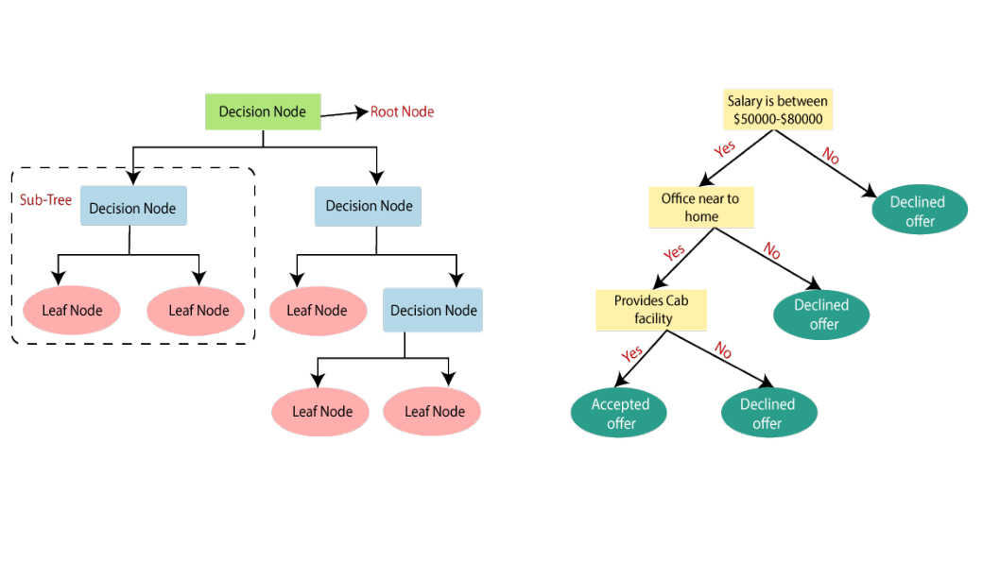
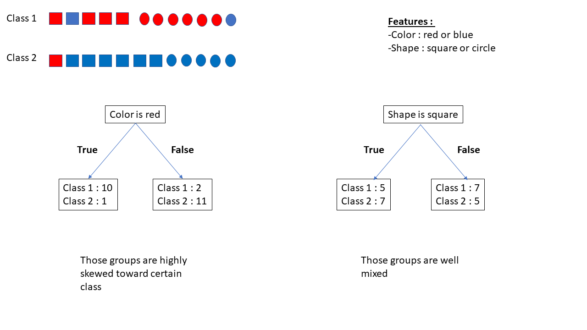
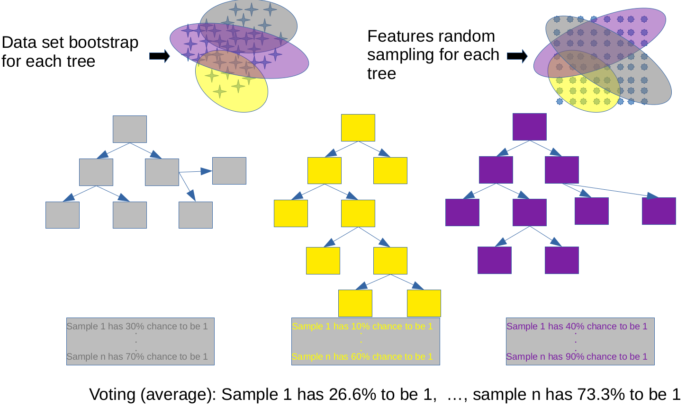

```{r setup, include=FALSE}
knitr::opts_chunk$set(echo = TRUE)
```


```{r}
library(tidyr)
library(dplyr)
library(ggplot2)
library(gridExtra)
library(tidymodels)
library(rpart.plot)
library(themis)
library(vip)
library(ranger)
```

In this notebook we are going to learn what a **decision tree** is, how it does classification and what the **hyperparameters** used to define it actually do and stand for.

Then we are going to superficially describe how decision trees are basic bricks of more powerful algorithms called **ensemble algorithms**. You will see that these algorithm can be quite diverse. Since they are quite useful and commonly used I will spend some time showing how different they actually are from one another and what that means. 

# Decision tree based classification

```{r}
BreastCancer <- read.csv("../data/breast_cancer.csv")

# IMPORTANT: ensure the "label of interest" is the first level of the factor !
# https://yardstick.tidymodels.org/reference/roc_curve.html#relevant-level
BreastCancer$malignant = factor( BreastCancer$malignant , levels = c(1,0))


## removing some extremely correlated features
BreastCancer <- BreastCancer %>% select( !c(mean.area,mean.perimeter,mean.concave.points)  ) 

split <- initial_split(BreastCancer, strata = malignant)
BC_train <- training(split)
BC_test  <- testing(split)

print( paste('train:',nrow( BC_train ) ) )
print( paste('test :',nrow( BC_test ) ) )
```


# Decision tree <a class="anchor" id="Decision-Tree"></a>

A simple **decision tree** reduces your problem into a **hierarchichal sequence of questions** on your features that can be answered by yes or no and which subdivides the data into 2 subgroups on which a new question is asked, and so on and so on.



Ok, but a huge number of trees can actually be built just by considering the different orders of questions asked. How does the algorithm deals with this?

Quite simply actually: it **tests all the features and chooses the most discriminative** (with respect to your target variable) : the feature where a yes or no question divides the data into 2 subsets which minimizes an **impurity measure**.

Imagine you have a dataset with feature color (red or blue) and feature shape (square or circle), and 2 target classes : 1 and 2.



Asking `"feature color is red"` gives you the following subgroups:
 * 10 class 1, and 1 class 2 (`"feature color is red" == True`)
 * 2 class 1, and 11 class 2 (`"feature color is red" == False`)

Asking `"feature shape is square"` gives you:
 * 5 class 1, and 7 class 2 (`True`) 
 * 7 class 1 and 5 class 2 (`False`)
 
 So, you will prefer asking `"feature color is red?"` over `"feature shape is square?"`: `"feature color is red?"` is more discriminative.

For categorical variables, the questions test for a specific category.
For **numerical variables, the questions use a threshold** to as a yes/no question.  

The **threshold is, again, chosen to minimize impurity**. And in turn the best threshold for a variable is used to estimate the discriminativeness of that variable.

Of course, you will have to compute this threshold at each step of your tree since at each step you are considering different subdatasets.

---

The **impurity is related to how much your feature splitting is still having mixed classes**. So the impurity ends up giving a score: the [Gini coefficient](https://en.wikipedia.org/wiki/Gini_coefficient).


#### Gini coefficient

$$Gini = 1- \sum_{j} p_j^2$$

The idea is to measure the **probability that a dummy classifier mislabels your data**.
**0 is best, 1 is worst.**

---

Before going further, just a little bit of vocabulary: 
* **Trees** are made of **nodes** (where the question is asked and where the splitting occurs). 
* A **branch** is the outcome of a splitting. 
* A **leaf** is the last node on a branch (no more splitting).


## Toy data : exploring hyperparameters


Let explore some hyperparameters of this method, in particular with the default `rpart` engine.
As you will see in those examples, they act like a regularization:
- `tree_depth`: the maximum number of consecutive questions to ask
- `min_n`: minimum number of points in a node to consider splitting it further
- `cost_complexity`: required minimal improvement per split 

```{r}
set.seed(123)
blob1 = data.frame( x = rnorm(60 , mean = -7 ),
                    y = rnorm(60 , mean = 2.5 , sd = 3 ),
                    label = '1')
blob2 = data.frame( x = rnorm(60 , mean = 6 ),
                    y = rnorm(60 , mean = -6 , sd = 3 ),
                    label = '2')
blob3 = data.frame( x = rnorm(60 , mean = 8 ),
                    y = rnorm(60 , mean = -3 , sd = 3 ),
                    label = '3')
blobs <- bind_rows( blob1 , blob2, blob3)
blobs <- blobs %>% mutate( label = as.factor(label) )

ggplot(blobs, aes(x=x,y=y,col=label)) + geom_point()
```
```{r}
DT = decision_tree(engine = 'rpart' , mode = 'classification') %>%
  fit( label ~ x+y , blobs )

table( blobs$label , (DT %>% predict( blobs ))$.pred_class )
```

```{r}
tree_obj <- extract_fit_engine(DT)

rpart.plot(
  tree_obj, 
  extra = 1
)
```

Well, this is a relatively reasonable tree, obtained from the default arguments of the rpart decision tree:

 * `tree_depth`: 30
 * `min_n`: 2
 * `cost_complexity`: 0.01

Let's see how it looks with more lax hyper-parameters.


No `cost_complexity` :

```{r}
DT = decision_tree(engine = 'rpart' , mode = 'classification',
                   tree_depth = 30,
                   min_n = 2,
                   cost_complexity = 0
                   ) %>%
  fit( label ~ x+y , blobs )
tree_obj <- extract_fit_engine(DT)

rpart.plot(
  tree_obj,
  extra = 1
)
```

We see way more overfitting now.

Let's keep `cost_complexity` at 0 but reduce `tree_depth`:

```{r}
DT = decision_tree(engine = 'rpart' , mode = 'classification',
                   tree_depth = 4, ## no more that 4 consecutive questions
                   min_n = 2,
                   cost_complexity = 0
                   ) %>%
  fit( label ~ x+y , blobs )
tree_obj <- extract_fit_engine(DT)

rpart.plot(
  tree_obj,
  extra = 1
)
```

Indeed only a maximum of 4 splitting events link the root to the leafs.

Now for `min_n`:

```{r}
DT = decision_tree(engine = 'rpart' , mode = 'classification',
                   tree_depth = 30,
                   min_n = 10, # at least 10 samples in a nodes to split
                   cost_complexity = 0
                   ) %>%
  fit( label ~ x+y , blobs )
tree_obj <- extract_fit_engine(DT)

rpart.plot(
  tree_obj,
  extra = 1
)
```
Here you can see that the second leaf on the left has >10 node and contains samples from 2 classes, but it does not get split.
This is because internally, `rpart` sets the minimum samples **per leaf** as `round(min_n/3)`

So in summary:
    
 * tree_depth: high value increase complexity
 * min_n: high value decrease complexity
 * cost_complexity: high value decrease complexity


---

There are 3 main advantages to this kind of methods:

* it works with all types of feature
* you don't need to rescale
* it already includes non linear fitting

**Moreover it is 'easy' to interpret.**

But... (yes there is a but, there is no free lunch)

Even with all of those hyperparamaters **they are still not great on new data (inaccuracy...).** 
Also, they tend to be slow to train.

We will see that in the real data example below and we will see more powerful techniques based on decision tree that are more costly but generalize better.


## Decision tree on the Cancer data set

#### Let's train our model properly

```{r}
table( BC_train$malignant )
```


```{r}
breast_recipe <- recipe( malignant ~ . , data = BC_train) %>%
  step_upsample(malignant) # handling the imbalance with upsampling 
  
breast_model <- decision_tree(
  tree_depth = 30, ## I put this as a fixed high value and will tune the rest
  min_n = tune(),
  cost_complexity = tune(),
  mode = 'classification') 

breast_wf <- 
  workflow() %>%
  add_model( breast_model ) %>%
  add_recipe( breast_recipe )

## prepare the grid of hyper-parameter values to test:
breast_grid <- grid_regular( min_n(range=c(5,50)) , 
                             cost_complexity(range = c(-10, -1)), # these are log10 transformed
                             levels = 10)

## Cross-Validation setup
folds <- vfold_cv(BC_train, v = 5)


breast_DT_res <- 
  breast_wf %>% 
  tune_grid(
    resamples = folds,
    grid = breast_grid
    )

breast_DT_res %>% 
  show_best(metric = "roc_auc", n = 5)
```

```{r}
## choose a combination of hyperparameter
best_model <- breast_DT_res %>% select_best(metric = "roc_auc")

final_DT <- breast_wf %>% 
  finalize_workflow(best_model) %>% # apply hyper-parameters
  last_fit(split)                   # fit with the train data

final_DT %>%
  collect_metrics()
```

```{r}
test_predictions = final_DT %>% collect_predictions()
table( test_predictions$malignant , test_predictions$.pred_class )
```


```{r}
roc_curve(test_predictions , .pred_1 , truth = malignant  ) %>% autoplot()
```

With decision tree, we can still get feature importance (by looking at how much the nodes using each feature decrease impurity in the tree).

```{r}
final_DT %>% 
  extract_fit_parsnip() %>% 
  vip()
```


##  Exercise : Decision tree

plot the tree corresponding to the best model found above with `plot_tree()` and interpret it.


```{r}


```


# Random Forest

the Random Forest algorithm relies on two main concepts : 

1. **randomly producing/training many different trees**
2. **agglomerating the predictions** of all these trees (mainly averaging)


The randomness between trees concerns:

* **[bootstrapping](https://en.wikipedia.org/wiki/Bootstrapping_(statistics)) of the training dataset**
* using only a **random subset of features**


**Bootstrapping:** sampling methods in which you randomly draw a subsample from your data, *with replacement*. The created replicate is the same size as the original distribution.

I am sure you can see intuitively how that is going to help generalization of our model.

So now on top of all the parameters seen before to create each individual trees of the forest, you also have a parameter controlling the number of trees in your forest.


> In the following plots we will compare the results of a random forest with a single decision tree with the same hyperparameter values




```{r}
RF = rand_forest(
  mode = "classification",
  engine = 'ranger',
  mtry = 2, # each tree will get x and y. default is floor(sqrt(ncols))
  trees = 100, ## 100 trees in this forest
  min_n = NULL ## 10 by default for classification
) %>%
  fit( label ~ x+y , blobs )

RF %>% predict( blobs , type = 'prob') # type = 'prob' to get the probability of each class
```

```{r}
## small function to show how the random forest partitions the space 
contour_random_forest <- function( RF ,data, event){
  # Make a grid to predict the whole space:
  grid <-
    crossing(
      x = seq(-12, 12, length.out = 250),
      y = seq(-12, 12, length.out = 250)
    )
  
  grid$RFres <- pull(RF %>% predict( grid , type = 'prob'), paste0('.pred_',event))
  print(grid%>%head())
  return( ggplot(grid, aes(x = x, y = y)) +
            geom_contour_filled( aes(z = RFres) , breaks =  seq(0,1.01,length.out=11) ) +
            geom_point(data = data , aes(x=x,y=y,col=label)) +
            ggtitle( paste('class',event) )
           )
}

contour_random_forest(RF, blobs , 2 )
```

We can see that the random forest offers a nuanced view of the feature space.


## Random forest on the Cancer data set

```{r}
breast_model <- rand_forest(
  mode = "classification",
  trees = tune(),
  min_n = tune()
  )  %>% # mtry is the square root of the number of features, we can keep it as is.
  set_engine( engine = 'ranger', importance = "impurity" ) ## important to get the feature importance later

breast_wf <- 
  workflow() %>%
  add_model( breast_model ) %>%
  add_recipe( breast_recipe )

## prepare the grid of hyper-parameter values to test:
breast_grid <- grid_random( trees(range=c(50,500)) , 
                             min_n(range = c(2, 50)), 
                             size = 20)

## Cross-Validation setup
folds <- vfold_cv(BC_train, v = 5)


breast_RF_res <- 
  breast_wf %>% 
  tune_grid(
    resamples = folds,
    grid = breast_grid
    )

breast_RF_res %>% 
  show_best(metric = "roc_auc", n = 5)
```

```{r}
## choose a combination of hyperparameter
best_model <- breast_RF_res %>% select_best(metric = "roc_auc")

final_RF <- breast_wf %>% 
  finalize_workflow(best_model) %>% # apply hyper-parameters
  last_fit(split)                   # fit with the train data

final_RF %>%
  collect_metrics()
```

```{r}
test_predictions = final_RF %>% collect_predictions()
table( test_predictions$malignant , test_predictions$.pred_class )
```


```{r}
roc_curve(test_predictions , .pred_1 , truth = malignant  ) %>% autoplot()
```

With decision tree, we can still get feature importance (by looking at how much the nodes using each feature decrease impurity in the tree).

```{r}
final_RF %>% 
  extract_fit_parsnip() %>% 
  vip()
```

It is also always possible to get feature importances using permutations: they are obtained by monitoring how model performance decrease when a single feature is shuffled.

> NB: this method works for all models, even the black box ones

```{r}
library(important)
perm_importances = importance_perm( final_RF$.workflow[[1]] , 
                                    data = BC_train,
                                    metrics = metric_set(roc_auc)
)

perm_importances
```
```{r}
perm_importances %>% autoplot()
```


# Exercise: predicting 10 year coronary heart disease outcome

The [framingham dataset](https://datacatalog.med.nyu.edu/dataset/10046) links some patient features to their risk to develop a heart disease.


```{r}
framingham = read.csv( '../data/framingham.csv' )
framingham$TenYearCHD = factor( framingham$TenYearCHD , levels = c(1,0))
framingham <- framingham %>% mutate_if(is.integer, as.numeric)
framingham %>% head()
```
```{r}
table(framingham$TenYearCHD)
```

```{r}
str(framingham)
```

---

Build and optimize a Random Forest to predict the column `'TenYearCHD'` (dependent variable : ten year risk of coronary heart disease).

> You can start and adapt from the previous notebook exercise's correction if you want


```{r}
# your code here:
```

Solution in `solutions/solution_framingham_RF.R`
